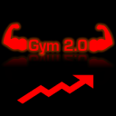
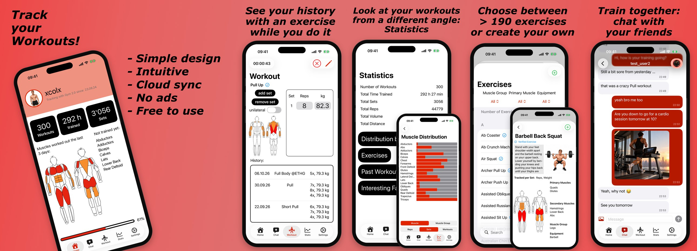

<p align="center">
  
</p>

<h1 align="center">Gym 2.0</h1>

<p align="center">
  A free, ad-free workout tracker for iOS and the web, with a self-hostable backend.
</p>

<p align="center">
  <a href="https://apps.apple.com/app/id6695759065">
    <picture>
      <source media="(prefers-color-scheme: dark)" srcset="https://toolbox.marketingtools.apple.com/api/v2/badges/download-on-the-app-store/white/en-us">
      
    </picture>
  </a>
  &nbsp;
  <a href="https://gym2.app"></a>
</p>

<p align="center">
  <a href="NOTICE"></a>
  
  
  
  
</p>

## Screenshots

<p align="center">
  <a href="https://apps.apple.com/app/id6695759065">
    
  </a>
</p>

The full-size App Store screenshots are in [docs/screenshots/app-store](docs/screenshots/app-store).

## Highlights

Gym 2.0 is designed, built and run by one developer, from the native iOS app to the production server.

- **Two clients, one sync model:** a native SwiftUI/SwiftData iOS app and a Next.js PWA that both work fully offline
  and sync with the backend once they're online again.
- **A production backend:** a FastAPI REST API on PostgreSQL with Flyway migrations, an admin interface, rate limits
  and scheduled maintenance jobs.
- **Content moderation:** uploaded images are checked for nudity on the server with NudeNet and rejected or queued
  for review, alongside blocking and reporting.
- **Self-hosted operations:** the whole stack runs in Docker behind Cloudflare and Traefik, with its own mail server and
  nightly encrypted backups to an offsite server with restic.
- **Shipped and maintained:** live on the App Store and at gym2.app, with CI that runs every test suite and builds every
  image on each pull request, plus weekly Dependabot updates.

## Table of contents

- [Screenshots](#screenshots)
- [Highlights](#highlights)
- [Features](#features)
- [Architecture](#architecture)
- [Getting started](#getting-started)
- [Documentation](#documentation)
- [Testing](#testing)
- [Deployment](#deployment)
- [Known limitations](#known-limitations)
- [Contributing](#contributing)
- [Security](#security)
- [License](#license)

## Features

- **Workouts:** track free workouts, follow your own workout schemes, take suggested workouts or repeat a past one.
- **Exercises:** an exercise library with the trained muscles highlighted and keyframe images that play the movement
  like a flip book when you swipe through them.
- **Statistics:** past workouts, the progress of each exercise, the distribution of your training and other facts.
- **Social:** friends, direct and group chats with images, blocking and reporting. Uploaded profile images, group
  images and chat photos are checked for nudity on the server with [NudeNet](https://github.com/notAI-tech/NudeNet),
  which rejects or reports them for review.
- **AI chat:** ask questions about your training.
- **Offline-first:** both apps keep working without a connection and sync with the backend once they're online again.
- **Import:** workouts from JSON and CSV files, as well as the CSV export of earlier versions of the app.
- **Metric and imperial units.**

## Architecture

| Folder | What it is | Stack |
| --- | --- | --- |
| [`ios/`](ios) | The iOS app, see [ios/README.md](ios/README.md) | SwiftUI, SwiftData |
| [`web/`](web) | The offline-first web app (PWA), see [web/README.md](web/README.md) | Next.js 16, React 19, Tailwind 4, Dexie |
| [`backend/`](backend) | The REST API (`/v1`), the admin interface and the database migrations, see [backend/README.md](backend/README.md) | FastAPI, SQLAlchemy, Flyway, PostgreSQL |
| [`infra/`](infra) | The Dockerfiles and operations of the production stack, see [infra/README.md](infra/README.md) | Docker |
| [`infra/mailserver/`](infra/mailserver) | Sends the account emails (verification, email change, password reset, already registered), only reachable by the backend | Node.js |
| [`infra/backup/`](infra/backup) | The nightly backup and the restore script | restic, pg_dump |
| [`infra/offsite-backup/`](infra/offsite-backup) | The server that stores the encrypted offsite backups, see [infra/offsite-backup/README.md](infra/offsite-backup/README.md) | restic, rest-server |

The web app talks to the backend only through its own origin: the Next.js server proxies `/api/*` to the backend
([web/src/proxy.ts](web/src/proxy.ts)). The iOS app calls the API directly.

### Lines of code

Counted with [scc](https://github.com/boyter/scc) and updated regularly, not on every push
([.github/scripts/update-loc.sh](.github/scripts/update-loc.sh)).

<!-- LOC:START -->
| Language | Files | Code | Comments | Blanks |
| --- | ---: | ---: | ---: | ---: |
| TypeScript | 368 | 29,368 | 2,911 | 3,762 |
| Swift | 181 | 19,990 | 2,688 | 3,722 |
| Python | 89 | 11,518 | 1,354 | 3,174 |
| JavaScript | 7 | 627 | 97 | 77 |
| YAML | 4 | 476 | 56 | 29 |
| HTML | 5 | 343 | 0 | 7 |
| SQL | 1 | 260 | 35 | 27 |
| CSS | 1 | 198 | 19 | 13 |
| Shell | 4 | 83 | 32 | 15 |
| Dockerfile | 5 | 69 | 12 | 38 |
| TOML | 1 | 45 | 1 | 7 |
| Docker ignore | 1 | 12 | 1 | 0 |
| INI | 1 | 8 | 0 | 0 |
| **Total** | **668** | **62,997** | **7,206** | **10,871** |
<!-- LOC:END -->

## Getting started

### Prerequisites

- [Docker](https://docs.docker.com/get-docker/) with Docker Compose
- [Node.js](https://nodejs.org) and npm, to run the web app outside Docker
- [Xcode](https://developer.apple.com/xcode/) for the iOS app (iOS 17 or later)

### Run the stack

```bash
git clone https://github.com/xcolx/Gym-2.0.git
cd Gym-2.0
docker compose up -d --build
```

This starts the development stack from [docker-compose.yml](docker-compose.yml):

| Service | URL | Notes |
| --- | --- | --- |
| `web` | http://localhost:3000 | Next.js dev server with hot reload |
| `backend` | http://localhost:5000 | API docs at http://localhost:5000/docs (not in production) |
| `db` | `localhost:5432` | PostgreSQL, user `admin`, password `dev_password`, database `gym2_db` |
| `flyway` | | Runs the migrations of [backend/db/migrations](backend/db/migrations) before the backend starts |
| `maintenance` | | Removes old data every day at 01:00 UTC |
| `mailserver` | | Needs `EMAIL_USER` and `EMAIL_PASS` (the login of a mailbox on the Stalwart mail server) to send emails |

To work on the web app outside Docker, start only the backend and run the web app with npm:

```bash
docker compose up -d db flyway backend
cd web
cp .env.example .env.local
npm install
npm run dev
```

### iOS app

Open [ios/Gym 2.0.xcodeproj](ios/Gym%202.0.xcodeproj) in Xcode and run the `Gym 2.0` scheme. It uses the production
API by default, [ios/README.md](ios/README.md) explains how to point it at the local backend.

## Documentation

Each part of the project has its own README with its setup, commands and tests:

| Document | What it covers |
| --- | --- |
| [backend/README.md](backend/README.md) | Running the API locally, configuration, migrations, jobs, tests |
| [web/README.md](web/README.md) | Running and building the web app, configuration, tests |
| [ios/README.md](ios/README.md) | Building the iOS app, using a local backend, project layout, tests |
| [infra/README.md](infra/README.md) | Deployment, logs, monitoring, backups and restores of the production stack |
| [infra/offsite-backup/README.md](infra/offsite-backup/README.md) | Setting up the server that stores the offsite backups |

How the code is organized and the conventions for changes are described in
[backend/ARCHITECTURE.md](backend/ARCHITECTURE.md) and [web/ARCHITECTURE.md](web/ARCHITECTURE.md).

## Testing

[.github/workflows/ci.yml](.github/workflows/ci.yml) runs every test suite on each push and pull request to `main`,
and builds every Docker image. To run them locally:

| Part | Command | Details |
| --- | --- | --- |
| Web | `npm run typecheck && npm run lint && npm test && npm run build` in `web/` | [web/README.md](web/README.md#testing) |
| Backend | `ruff check . && mypy && pytest` in `backend/`, against a separate test database | [backend/README.md](backend/README.md#testing) |
| iOS | ⌘U on the `Gym 2.0` scheme in Xcode | [ios/README.md](ios/README.md#testing) |

## Deployment

Production runs with [docker-compose.prod.yml](docker-compose.prod.yml) and its secrets in `.env` (see
[.env.example](.env.example)). The setup, the logs, monitoring, the nightly backups and how to restore them are
described in [infra/README.md](infra/README.md).

## Known limitations

- **Security is handled outside this repository.** TLS, the firewall and the public entry point are provided by the
  infrastructure in front of the stack: requests go client → Cloudflare → reverse proxy (Traefik, configured in
  homeserver-infra) → web or backend. This repository only covers the application itself (authentication, rate limits,
  content and nudity filters) and trusts the forwarded client addresses of these proxies (see
  [docker-compose.prod.yml](docker-compose.prod.yml)).
- **No OAuth login yet.** Accounts sign up and log in with email and password. OAuth (e.g. Sign in with Apple or
  Google) will be implemented later, the backend only contains stubs for it.
- **English only.** The apps are only available in English. Support for other languages will be added later, the
  backend already stores a language per user (`language`, set through PATCH /v1/users/me), but no app sets or uses it yet.
- **Imperial weights drift.** Weights are always stored in kilograms with one decimal (`NUMERIC(5,1)`), so a value
  entered in pounds is rounded when it's converted: 100 lbs becomes 45.4 kg and is shown as 100.1 lbs afterwards.
  Distances don't have this problem, they are stored in meters with three decimals.

## Contributing

Bug reports, ideas and pull requests are welcome. Please read [CONTRIBUTING.md](CONTRIBUTING.md) first: larger changes
should start with an issue, and contributors sign the [Contributor License Agreement](CLA.md) once on their first pull
request.

## Security

Please don't open a public issue for security problems. Report them privately on the Security tab or by email to
[security@colinrueegg.com](mailto:security@colinrueegg.com), see [SECURITY.md](SECURITY.md).

## License

Copyright (C) 2024-2026 Colin Rüegg. Gym 2.0 is licensed under the [GNU Affero General Public License v3](LICENSE)
with an additional permission to distribute it through app stores and an attribution requirement: every version with a
user interface, including hosted ones, must show "Based on Gym 2.0 by Colin Rüegg - www.colinrueegg.com". The name
"Gym 2.0" and its logos are not licensed. See [NOTICE](NOTICE) for the exact terms.
